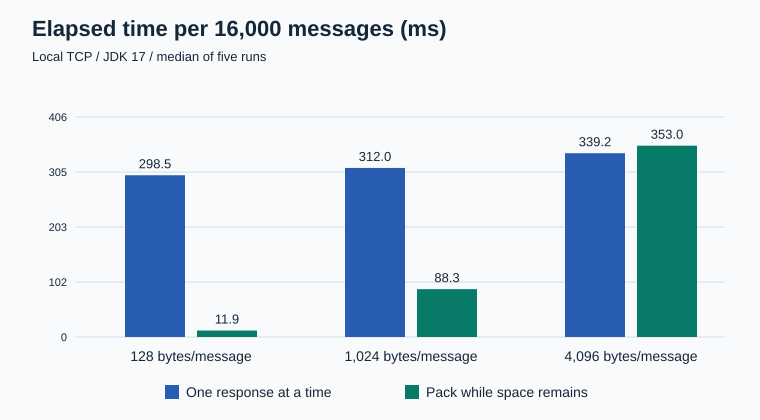
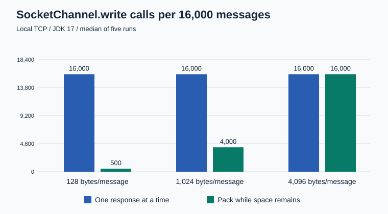

# 发送缓冲区批量追加实验

实验日期：2026-11-14。

## 为什么改

逐条发送时，即使多条小响应已经在发送队列里，Worker 也要为每条响应单独调用 `SocketChannel.write()`。我想利用当前发送缓冲区的剩余空间，把已经排队的小响应合在一起写，看看能减少多少写调用以及整批发送耗时。

## 改了什么

- 逐条模式发完当前响应后再装下一条。
- 批量模式用 `compact()` 保留尚未写出的字节，再按 FIFO 追加装得下的队头响应。暂时装不下的响应留在队列里，等现有数据发出后再处理。
- 两种模式都在填充后用 `flip()` 设置发送范围。Socket 暂时写不下时，保留剩余字节，等待可写后续传。

项目实现见 [WorkerLoop.write()](../../../src/main/java/Core/WorkerLoop.java)。以下数字来自本目录的独立程序，测试的是两种发送策略。

## 测试方法

Windows 本机 TCP 回环，JDK 17.0.12，`TCP_NODELAY` 开启。每轮通过一条连接发送 16,000 条预先生成的同尺寸负载，发送缓冲区从 1024 B 起，最多 4096 B。每组预热两轮，测量五轮，取中位数。计时从发送循环开始，到对端读完所有字节为止，接收端校验字节内容和顺序。

## 结果

| 每条负载 | 逐条耗时 | 批量耗时 | 逐条 write 调用 | 批量 write 调用 |
| --- | ---: | ---: | ---: | ---: |
| 128 B | 298.511 ms | 11.929 ms | 16,000 | 500 |
| 1024 B | 311.979 ms | 88.286 ms | 16,000 | 4,000 |
| 4096 B | 339.174 ms | 353.048 ms | 16,000 | 16,000 |

128 B 时，每个满缓冲区能容纳 32 条消息，写调用减少约 97%，整批耗时约为逐条的 1/25。1024 B 时每批最多合并四条。4096 B 时单条就占满缓冲区，写调用数相同，两组耗时范围重叠。





两种模式均能发送 4095 B 和 4096 B 的单条负载。遇到 4097 B 时，测试程序发完前一条合法消息后结束发送，超限消息及其后的消息均未发送。见[原始采样](results.csv)和[边界记录](boundary.txt)。

这些结果适用于预先备齐数据的本机单连接发送场景。实际 HTTP 服务的吞吐、延迟和 Worker 行为仍需端到端验证。

## 复现

进入本目录，用 PowerShell 和 JDK 17 执行：

```powershell
javac -d out Bench.java
foreach ($size in 128, 1024, 4096) {
    java -cp out Bench single $size
    java -cp out Bench batch $size
}
java -cp out Bench single boundary
java -cp out Bench batch boundary
```

记录方式参考 [OpenJDK JMH 的独立基准运行说明](https://github.com/openjdk/jmh)和 [gRPC Java 的 benchmark README](https://github.com/grpc/grpc-java/tree/master/benchmarks)。
